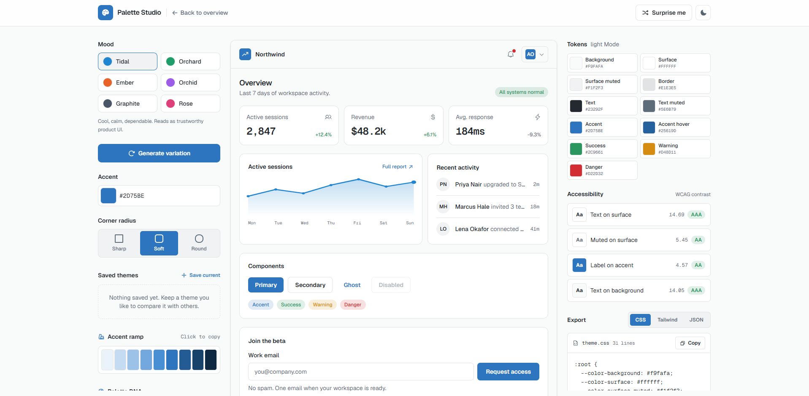

<div align="center">

# 🎨 Theme Generator

**Design, preview, and export complete UI color themes in seconds.**

Built with Next.js, React, and TypeScript.

[](https://nextjs.org)
[](https://www.typescriptlang.org)
[](https://react.dev)
[](https://eslint.org)
[](https://vercel.com)
[](#-license)

[Live Demo](#-live-demo) · [Features](#-features) · [Getting Started](#-getting-started) · [Project Structure](#-project-structure) · [Roadmap](#-roadmap) · [Contributing](#-contributing)

</div>

---

## 📖 Table of Contents

1. [About the Project](#-about-the-project)
2. [Live Demo](#-live-demo)
3. [Screenshots](#-screenshots)
4. [Features](#-features)
5. [Tech Stack](#-tech-stack)
6. [Getting Started](#-getting-started)
7. [Available Scripts](#-available-scripts)
8. [Project Structure](#-project-structure)
9. [How It Works](#-how-it-works)
10. [Usage Guide](#-usage-guide)
11. [Customization](#-customization)
12. [Accessibility](#-accessibility)
13. [Deployment](#-deployment)
14. [Roadmap](#-roadmap)
15. [Contributing](#-contributing)
16. [Troubleshooting](#-troubleshooting)
17. [FAQ](#-faq)
18. [License](#-license)
19. [Author](#-author)
20. [Acknowledgements](#-acknowledgements)

---

## 🧭 About the Project

**Theme Generator** is a web application that helps designers and developers create consistent, good-looking color themes for their websites and apps without manually picking and tweaking dozens of color values.

Choosing a palette is one of the most time-consuming parts of building a UI. You need a primary color, supporting colors, backgrounds, surfaces, borders, text colors, and states, and all of them have to work together in both light and dark modes. This project automates that process: pick your inputs, see the result live, and take the generated theme straight into your own project.

### 🎯 Goals

- Make theme creation **fast** and **visual**.
- Produce themes that are **consistent** and **readable**.
- Output values that are **easy to drop** into any frontend project.
- Keep the codebase **clean, typed, and easy to extend**.

### 👥 Who Is It For?

| Audience | How it helps |
| --- | --- |
| Frontend developers | Generate a ready-to-use theme instead of hand-writing color tokens |
| UI/UX designers | Explore palettes quickly and preview them on real components |
| Students & beginners | Learn how design tokens and theming work in a modern Next.js app |
| Hackathon teams | Get a polished look for a project in minutes |

---

## 🚀 Live Demo

> 🔗 **Live site:** _Add your deployed link here (for example, your Vercel URL)._

```text
https://theme-generator-liart.vercel.app
```

---

## 🖼️ Screenshots

> Added screenshot so that you can check the Preview of The Project:



---

## ✨ Features

### Core

- 🎨 **Theme generation**: create a full set of color tokens from your chosen inputs.
- 👀 **Live preview**: see the theme applied instantly as you make changes.
- 🌗 **Light & dark support**: design for both modes side by side.
- 📋 **Export-ready output**: copy the generated values and use them in your own project.
- ⚡ **Fast and lightweight**: built on the Next.js App Router for quick loads and smooth navigation.

### Developer Experience

- 🧩 **Typed theme logic** written in TypeScript, kept separate from the UI in `lib/theme`.
- 🧹 **Linting** with ESLint for consistent code quality.
- 🔤 **Optimized fonts** using `next/font` with the Geist font family.
- 🤖 **AI-agent friendly**: the repo includes an `AGENTS.md` and agent skill folders to guide AI coding assistants.

> 📝 **Note:** Adjust this list to match exactly what your app does. Remove anything that is not implemented yet and move it to the [Roadmap](#-roadmap).

---

## 🛠️ Tech Stack

| Layer | Technology |
| --- | --- |
| Framework | [Next.js](https://nextjs.org) (App Router) |
| Language | [TypeScript](https://www.typescriptlang.org) |
| UI Library | [React](https://react.dev) |
| Linting | [ESLint](https://eslint.org) |
| Fonts | [Geist](https://vercel.com/font) via `next/font` |
| Hosting | [Vercel](https://vercel.com) |
| Package Manager | npm (also works with yarn, pnpm, or bun) |

> 💡 Check your `package.json` for the exact dependency versions and any extra libraries (styling, color utilities, icons) and add them to this table.

---

## 🏁 Getting Started

### Prerequisites

Make sure you have these installed:

- **Node.js** 18.18 or later (20+ recommended)
- **npm**, **yarn**, **pnpm**, or **bun**
- **Git**

Check your versions:

```bash
node -v
npm -v
git --version
```

### Installation

**1. Clone the repository**

```bash
git clone https://github.com/Abhinavkr004/Theme-Generator.git
```

**2. Move into the project folder**

```bash
cd Theme-Generator
```

**3. Install dependencies**

```bash
npm install
```

Or with another package manager:

```bash
yarn install
# or
pnpm install
# or
bun install
```

**4. Start the development server**

```bash
npm run dev
```

**5. Open the app**

Visit [http://localhost:3000](http://localhost:3000) in your browser. The page hot-reloads as you edit files, so start with `app/page.tsx`.

### Environment Variables

If your project needs environment variables, create a `.env.local` file in the root:

```bash
cp .env.example .env.local
```

```env
# Example
NEXT_PUBLIC_APP_NAME="Theme Generator"
```

> ⚠️ Never commit real secrets. `.env.local` is already ignored by `.gitignore`.

---

## 📜 Available Scripts

| Command | What it does |
| --- | --- |
| `npm run dev` | Starts the development server with hot reload |
| `npm run build` | Creates an optimized production build |
| `npm run start` | Runs the production build locally |
| `npm run lint` | Runs ESLint across the project |

---

## 🗂️ Project Structure

```text
Theme-Generator/
├── .agents/skills/       # Skill files for AI coding agents
├── .kiro/skills/         # Skill files for Kiro
├── app/                  # Next.js App Router (pages, layouts, global styles)
├── lib/
│   └── theme/            # Core theme generation logic
├── public/               # Static assets (images, icons)
├── AGENTS.md             # Guidelines for AI coding agents
├── eslint.config.mjs     # ESLint configuration
├── next.config.ts        # Next.js configuration
├── package.json          # Dependencies and scripts
├── tsconfig.json         # TypeScript configuration
└── README.md             # You are here
```

### Folder Details

- **`app/`** holds the routes, layouts, and the main UI. Editing `app/page.tsx` changes the home page.
- **`lib/theme/`** contains the logic that turns user input into a theme. Keeping it outside the UI makes it easier to test and reuse.
- **`public/`** serves static files directly from the root URL.
- **`AGENTS.md`** tells AI coding tools how this project is organized and how to work in it.

---

## ⚙️ How It Works

At a high level, the app follows a simple pipeline:

```text
 User input  ──►  Theme logic (lib/theme)  ──►  Generated tokens  ──►  Live preview  ──►  Export
```

1. **Input**: you choose the base values for your theme (for example, a primary color and a mode).
2. **Generation**: the logic in `lib/theme` derives the rest of the palette, such as backgrounds, surfaces, borders, text, and accents.
3. **Preview**: the UI applies the generated tokens so you can see exactly how components will look.
4. **Export**: copy the resulting theme values and paste them into your own project.

### Example Output

The exact format depends on your implementation. A typical result might look like this:

```css
:root {
  --background: #ffffff;
  --foreground: #0f172a;
  --primary: #6366f1;
  --primary-foreground: #ffffff;
  --secondary: #e2e8f0;
  --muted: #f1f5f9;
  --border: #e2e8f0;
  --ring: #6366f1;
}

.dark {
  --background: #0b1020;
  --foreground: #e2e8f0;
  --primary: #818cf8;
  --primary-foreground: #0b1020;
  --secondary: #1e293b;
  --muted: #111827;
  --border: #1f2937;
  --ring: #818cf8;
}
```

---

## 🧑‍💻 Usage Guide

1. Open the app in your browser.
2. Pick your base color(s) and mode.
3. Watch the preview update in real time.
4. Fine-tune values until the theme feels right.
5. Copy the generated output.
6. Paste it into your project's global stylesheet or theme config.

### Using the Theme in Your Own Project

**With plain CSS variables:**

```css
body {
  background: var(--background);
  color: var(--foreground);
}

.button-primary {
  background: var(--primary);
  color: var(--primary-foreground);
  border: 1px solid var(--border);
}
```

**With a TypeScript theme object:**

```ts
export const theme = {
  background: "#ffffff",
  foreground: "#0f172a",
  primary: "#6366f1",
} as const;
```

---

## 🎛️ Customization

You can extend the project in a few simple ways:

- **Add new token types** (success, warning, danger, info) inside `lib/theme`.
- **Add new presets** such as Ocean, Sunset, Forest, or Monochrome.
- **Change the default font** by editing the `next/font` setup in `app/layout.tsx`.
- **Add new export formats** like CSS variables, JSON, Tailwind config, or SCSS.

### Adding a New Preset (Example)

```ts
// lib/theme/presets.ts
export const presets = {
  ocean: { primary: "#0ea5e9", mode: "light" },
  sunset: { primary: "#f97316", mode: "light" },
  midnight: { primary: "#818cf8", mode: "dark" },
};
```

---

## ♿ Accessibility

Good themes are readable themes. When using or extending this project, keep these in mind:

- Aim for a **contrast ratio of at least 4.5:1** for normal text and **3:1** for large text (WCAG AA).
- Do not rely on color alone to communicate meaning.
- Test both light and dark modes.
- Make sure focus states are clearly visible.

---

## ☁️ Deployment

### Deploy on Vercel (recommended)

1. Push your code to GitHub.
2. Go to [vercel.com/new](https://vercel.com/new) and import the repository.
3. Keep the default Next.js settings and click **Deploy**.

Your app will be live at a `*.vercel.app` URL. Every push to `main` triggers a new deployment automatically.

### Build and Run Manually

```bash
npm run build
npm run start
```

For more details, see the [Next.js deployment docs](https://nextjs.org/docs/app/building-your-application/deploying).

---

## 🤝 Contributing

Contributions are welcome and appreciated.

1. **Fork** the repository.
2. **Create a branch** for your change:
   ```bash
   git checkout -b feature/your-feature-name
   ```
3. **Make your changes** and keep the code clean and typed.
4. **Run the linter**:
   ```bash
   npm run lint
   ```
5. **Commit** with a clear message:
   ```bash
   git commit -m "feat: add your feature"
   ```
6. **Push** your branch:
   ```bash
   git push origin feature/your-feature-name
   ```
7. **Open a Pull Request** describing what you changed and why.

### Commit Message Style

| Prefix | Use for |
| --- | --- |
| `feat:` | A new feature |
| `fix:` | A bug fix |
| `docs:` | Documentation changes |
| `style:` | Formatting only, no logic change |
| `refactor:` | Code restructuring |
| `chore:` | Tooling and maintenance |

### Reporting Bugs

Open an [issue](https://github.com/Abhinavkr004/Theme-Generator/issues) and include:

- What you expected to happen
- What actually happened
- Steps to reproduce
- Your browser and OS
- Screenshots, if helpful

---

## 🩺 Troubleshooting

| Problem | Fix |
| --- | --- |
| `npm install` fails | Delete `node_modules` and `package-lock.json`, then run `npm install` again |
| Port 3000 is busy | Run `npm run dev -- -p 3001` |
| Styles look stale | Stop the server, delete the `.next` folder, and restart |
| Type errors after pulling changes | Run `npm install` to sync dependencies |
| Node version errors | Upgrade to Node 18.18+ (20+ recommended) |

---

## ❓ FAQ

**Is this free to use?**
Yes, for educational purposes only. See the [License](#-license) section.

**Can I use this project commercially?**
No. This project is shared for educational purposes only.

**Does it work with Tailwind CSS?**
You can map the generated tokens into a Tailwind config or CSS variables. See [Customization](#-customization).

**Can I contribute new presets?**
Absolutely. Open a pull request with your preset and a short description.

---

## 📄 License

This project is created for **educational purposes only**.

It is shared to demonstrate learning and skills in web development. It is not intended for commercial use, resale, or redistribution as a product.

---

## 👤 Author

**Abhinav Kumar**

- GitHub: [@Abhinavkr004](https://github.com/Abhinavkr004)

If you find this project useful, please consider giving it a ⭐ on GitHub!

---

## 🙏 Acknowledgements

- [Next.js](https://nextjs.org) for the framework
- [Vercel](https://vercel.com) for hosting and the Geist font
- [React](https://react.dev) for the UI library
- [Shields.io](https://shields.io) for the README badges
- Everyone who tests, shares feedback, and contributes

---

<div align="center">

**Made with ❤️ by Abhinav Kumar**

</div>
